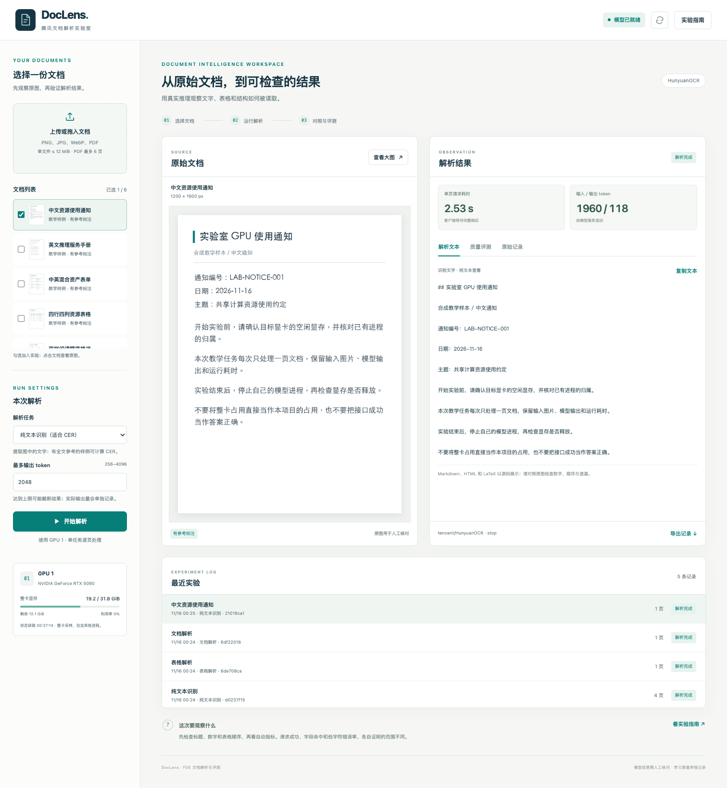

# DocLens：HunyuanOCR 文档解析与评测实验室

基于腾讯 **HunyuanOCR-1.5** 与 vLLM 的单卡文档解析项目：上传图片或 PDF，查看原图与模型输出，保留真实耗时、token 用量、结束原因和规则评测。

独立仓库：[23dfg-df/fde2](https://github.com/23dfg-df/fde2)。

这是独立的文档入口项目，侧重 OCR、多模态推理、异步任务与质量核验。另一个仓库 [FDE 知识库助手](https://github.com/23dfg-df/FDE-) 侧重检索、重排、引用与知识库问答。两者分别展示；本版本尚未自动把解析结果写入知识库索引。

项目不是腾讯官方产品。上游模型、框架和原创应用代码的来源分别说明，见 [第三方来源](THIRD_PARTY_NOTICES.md)。



截图来自 2026-11-16 的真实 RTX 5090 实验；它是历史记录，不表示当前服务器状态，也不代表所有文档的准确率。

## 功能与边界

| 能力 | 已实现范围 |
|---|---|
| 输入 | PNG/JPG/WebP/PDF，单文件不超过 12 MiB、PDF 不超过 6 页 |
| 图像准备 | 校正方向、RGB 转换，长边不超过 1600px；PDF 使用 PyMuPDF 栅格化 |
| 模型任务 | 纯文本识别、正文 Markdown 解析、HTML 表格解析 |
| 异步作业 | 全应用一个任务、逐页串行；取消发生在当前页结束后 |
| 核验 | 原图对照、CER、字段值覆盖、HTML 单元格覆盖 |
| 可观测性 | HTTP 墙钟耗时、实际 usage、结束原因、GPU 整卡快照 |
| 结果留存 | SQLite 历史、JSON/Markdown 导出、中断恢复标记 |

模型输出按纯文本显示，不作为可信 HTML 执行。`completed` 仅表示生成正常返回；评分不能替代人工核验。没有标注的上传文档不产生自动准确率。

## 架构与源码


| 文件 | 职责 |
|---|---|
| `backend/main.py` | API 路由、输入校验、上传与静态页面 |
| `backend/service.py` | 任务状态、串行调用模型、错误和指标记录 |
| `backend/repository.py` | SQLite 数据访问 |
| `backend/images.py` | 图片解码与 PDF 栅格化 |
| `backend/evaluation.py` | 文本、字段、表格规则评分 |
| `web/` | 无 CDN、无构建步骤的真实服务界面 |
| `samples/` | 6 页原创合成文档、参考标签及可重建脚本 |
| `evidence/` | 经过筛选的历史实测记录、冻结依赖与截图 |

## 先在 CPU 上检查源码

CPU 检查不需要模型、GPU 或实验室服务器。使用 Python 3.12：

```bash
python3 -m venv .venv-app
.venv-app/bin/python -m pip install -r requirements-app.txt
.venv-app/bin/python -m pytest tests -q
node --check web/app.js
```

`.github/workflows/ci.yml` 执行相同的 CPU 契约测试、依赖检查和脚本语法检查。测试使用模拟模型响应；CI 通过不能替代真实 GPU 质量和性能验收。

也可以只启动应用、浏览样本和 API 文档：

```bash
bash scripts/start_app.sh
```

在本机访问 `http://127.0.0.1:18400/`；未启动独立模型服务时，界面会显示模型未就绪，并禁用解析。API 文档在 `/docs`。

## 在自己的 GPU 服务器运行

历史实测环境为 Ubuntu、Python 3.12、RTX 5090 32 GiB、vLLM 0.18.1、PyTorch 2.10.0、Transformers 4.57.6。固定模型提交：

```text
47644ecc4fc854efa4f505155158831f36773ee4
```

仓库不包含权重、虚拟环境、数据库、上传文件、私人服务器地址或凭据。权重下载约 2.25 GB，模型环境还需要额外磁盘空间；按自己的机器核对 CUDA、空间和可用显存。

先查看 `nvidia-smi`，选定一张可用 GPU。以下例子使用物理 GPU 1，要求启动前至少有 24 GiB 可用显存；如选其他卡，应用与模型终端应设置相同的 `OCR_PHYSICAL_GPU`。默认 60% 是 vLLM 显存规划，不能当作硬件隔离。

```bash
mkdir -p logs evidence
export OCR_PHYSICAL_GPU=1
export OCR_BOOTSTRAP_PYTHON=python3
python3 scripts/download_model.py --directory ../models/HunyuanOCR-1.5
bash scripts/install_model_environment.sh
bash scripts/install_app_environment.sh
```

安装脚本用一个已有 pip 的 Python 向新环境安装依赖；该 pip 需要支持 `--python`（pip ≥ 22.3）。可把 `OCR_BOOTSTRAP_PYTHON` 指向自己的 Miniforge 等环境。默认采用公开 PyPI，可按网络设置 `PIP_INDEX_URL`。不把新依赖安装进已有模型环境。

若系统缺 Python 3.12 编译头文件，在 Ubuntu 上可执行以下脚本：它只将发行版开发包下载、解包到项目 `.tools/`，不使用 sudo 修改系统包。若已有开发头文件，则跳过此步。

```bash
python3 scripts/prepare_python_headers.py
```

在第一个终端启动模型：

```bash
export OCR_PHYSICAL_GPU=1
bash scripts/start_model.sh
```

在第二个终端启动应用并检查状态：

```bash
export OCR_PHYSICAL_GPU=1
bash scripts/start_app.sh
```

在第三个终端查询：

```bash
curl -sS http://127.0.0.1:18400/api/status | python3 -m json.tool --no-ensure-ascii
```

`model_ready: true` 后再提交样本。两个服务均默认只监听服务器回环地址。在自己的电脑上建立 SSH 转发，再访问本机 18400 端口：

```bash
ssh -N -L 18400:127.0.0.1:18400 YOUR_USER@YOUR_SERVER
```

直接前台启动时，使用对应终端的 Ctrl+C 停止。也可按 [部署与排障](docs/部署与排障.md) 安装本项目专用用户服务；模型用户服务配置 8 小时运行上限，前台脚本本身不自动计时。服务不会开机自启。

## 固定版本与实际兼容处理

该模型配置使用 `rope_parameters`，vLLM 0.18.1 的部分路径仍读取 `rope_scaling`。`scripts/model_overrides.py` 在启动时镜像参数，保留原始配置和权重。当前依赖与兼容处理已通过历史实测；在其他驱动、硬件或未来依赖组合下仍需重新验收。

`requirements-app.txt` 是应用直接依赖。`evidence/*requirements.freeze.txt` 是历史环境快照；GPU 环境不能用 CPU CI 的结果替代验证。

## 2026-11-16 历史实测

共 5 个任务、8 次页面解析正常结束：6 页原创合成样本、1 页上传 PDF 和 1 次同参数复跑。详细数据见 [实测报告](docs/首轮实测报告.md) 和 [原始汇总](evidence/acceptance-summary.json)。

| 样本 | HTTP 请求耗时 | 规则结果 |
|---|---:|---|
| 中文通知首次请求 | 99.817 秒 | CER 1.0638% |
| 中文通知后续复跑 | 2.532 秒 | CER 1.0638%，与首次文本相同 |
| 英文手册 | 2.355 秒 | CER 1.3021% |
| 资产表单 | 2.607 秒 | 字段值覆盖 8/8 |
| 双栏文档 | 3.126 秒 | CER 0.9804% |
| 低对比小字 | 5.250 秒 | CER 0.8130%，出现 I/l 混淆 |
| HTML 表格 | 2.914 秒 | 单元格覆盖 16/16 |
| 上传 PDF | 2.610 秒 | 无参考，不给自动分数 |

166 次约 1 秒整卡采样中，GPU 1 最高观察占用为 19691 MiB，最少剩余 12420 MiB。这是整卡采样最大值，不是真实瞬时进程峰值。首次慢请求完整保留，没有以平均数隐藏；本项目未完成内核级冷启动归因。

CER 含 Markdown 标记造成的格式差异；字段覆盖不验证键值关联，单元格覆盖不验证行列结构。历史样本成绩不能推广为真实企业文档准确率。当前版本没有训练或微调模型。

## 学习与接续

1. [先完成一页文档解析](docs/第一课_看懂一次文档解析.md)：先预测，再运行、对照和解释。
2. [隔几天回来如何继续](docs/重新开始学习.md)：恢复环境、查看状态、做一个独立小任务。
3. [样本与评测口径](docs/样本与评测说明.md)：区分文字错误、格式差异和结构错误。
4. [部署与排障](docs/部署与排障.md)：复现本轮真实遇到的依赖和运行时问题。
5. [开源项目接续路线](docs/opensource-roadmap.md)：从 WeKnora 一页导入开始，再做 vLLM 性能实验与 tRPC 工具工作流。

应用和文档已经实现不等于学习者已掌握。建议把自己的操作记录、解释与未解决问题放在私有学习笔记中；公开仓库不发布个人学习表现。

## 来源与许可

上游为 [Tencent HunyuanOCR](https://github.com/Tencent-Hunyuan/HunyuanOCR)、[vLLM](https://github.com/vllm-project/vllm) 及其他依赖。模型采用上游模型许可证；各软件依赖适用各自许可。原创应用源码目前尚未选择许可证，未默认添加 MIT。详见 [THIRD_PARTY_NOTICES.md](THIRD_PARTY_NOTICES.md)。
